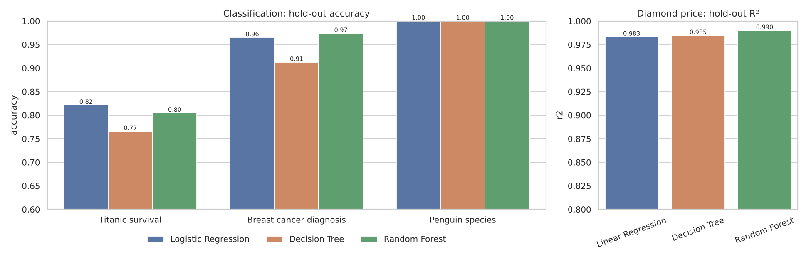
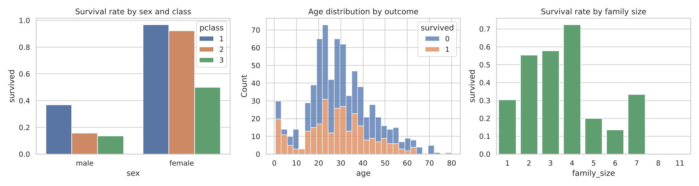
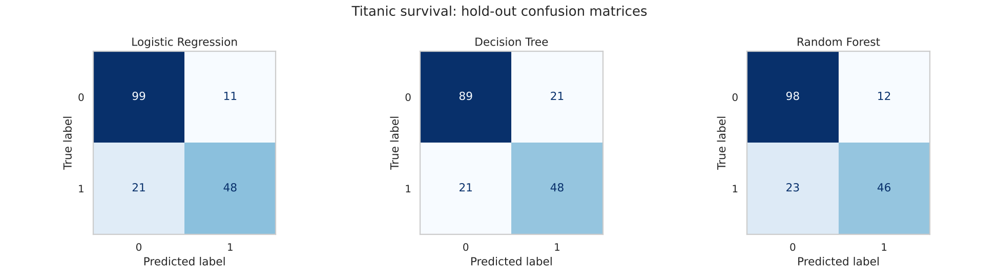
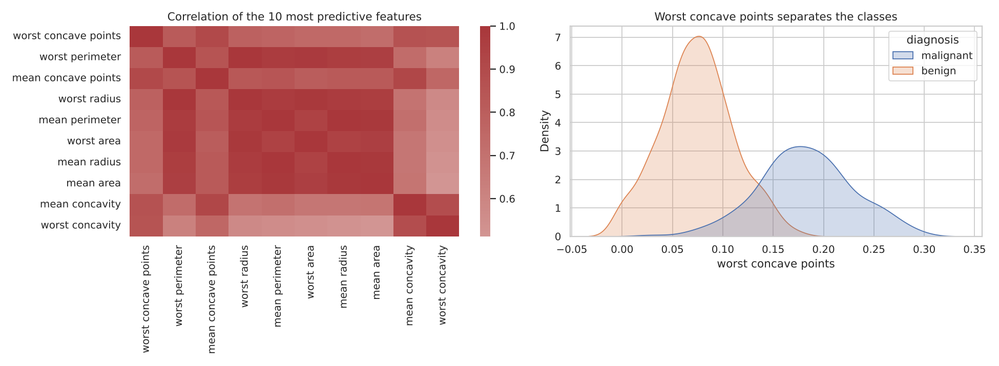
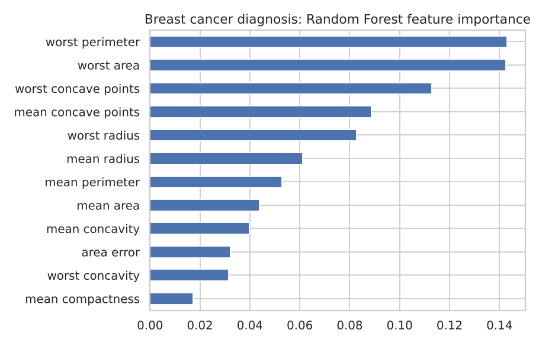
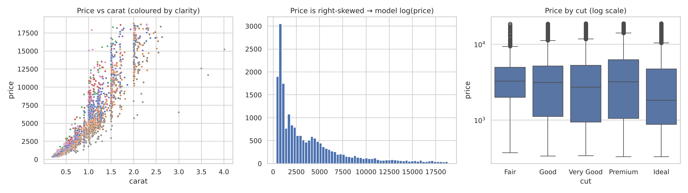
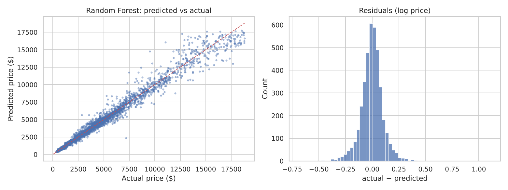

# Data Mining and Predictive Analytics

An end-to-end, reproducible comparison of classic machine-learning models (**Logistic / Linear Regression, Decision Trees, Random Forests**) on four real-world tabular datasets, covering both **classification** and **regression**.

Every model is trained inside a scikit-learn `Pipeline` (imputation → scaling → one-hot encoding → model), tuned with 5-fold cross-validated grid search on an 80 % training split, and scored once on an untouched 20 % hold-out set.

## Datasets

| Dataset | Task | Rows | Target | Source |
|---|---|---|---|---|
| Titanic | Binary classification | 891 | Survived | [seaborn-data](https://github.com/mwaskom/seaborn-data) |
| Breast Cancer Wisconsin | Binary classification | 569 | Malignant vs benign | `sklearn.datasets` (UCI) |
| Palmer Penguins | Multi-class classification | 344 | Species (3) | [seaborn-data](https://github.com/mwaskom/seaborn-data) |
| Diamonds | Regression | 53,940 (20k sampled) | log(price) | [seaborn-data](https://github.com/mwaskom/seaborn-data) |

## Feature engineering

- **Titanic:** `family_size`, `is_alone`, `fare_per_person`, `age_missing` flag, `child` flag; median / mode imputation for missing age and port.
- **Penguins:** `bill_ratio` (length / depth), `mass_per_flipper`.
- **Diamonds:** removed rows with impossible zero dimensions, added `volume` and `log_carat`, modelled `log(price)` because price is heavily right-skewed.
- **All:** numeric features standardised, categoricals one-hot encoded, all fitted on training folds only (no leakage).

## Results (20 % hold-out set)

### Classification

| Dataset | Model | CV F1 (macro) | Accuracy | F1 (macro) | ROC-AUC |
|---|---|---|---|---|---|
| Titanic | **Logistic Regression** | 0.796 | **0.821** | **0.805** | **0.861** |
| Titanic | Decision Tree | 0.806 | 0.765 | 0.752 | 0.795 |
| Titanic | Random Forest | 0.814 | 0.804 | 0.786 | 0.838 |
| Breast Cancer | Logistic Regression | 0.972 | 0.965 | 0.962 | **0.996** |
| Breast Cancer | Decision Tree | 0.924 | 0.912 | 0.903 | 0.919 |
| Breast Cancer | **Random Forest** | 0.957 | **0.974** | **0.971** | 0.994 |
| Penguins | Logistic Regression | 0.997 | 1.000 | 1.000 | 1.000 |
| Penguins | Decision Tree | 0.986 | 1.000 | 1.000 | 1.000 |
| Penguins | Random Forest | 0.992 | 1.000 | 1.000 | 1.000 |

### Regression (Diamond price)

| Model | CV R² | R² | MAE ($) | MAPE |
|---|---|---|---|---|
| Linear Regression | 0.976 | 0.983 | 400 | 10.3 % |
| Decision Tree | 0.983 | 0.985 | 347 | 9.4 % |
| **Random Forest** | 0.989 | **0.990** | **290** | **7.5 %** |



## Key findings

1. **Ensembles beat single trees everywhere.** Random Forest improved on a single tuned Decision Tree on every dataset (e.g. Breast Cancer accuracy 0.91 → 0.97, diamond MAE $347 → $290).
2. **Simple models remain competitive.** On Titanic, regularised Logistic Regression had the best hold-out accuracy (82 %) and AUC; with fewer than 1,000 rows, extra model capacity mostly adds variance.
3. **Sex and class drive Titanic survival.** Women in 1st/2nd class survived at more than 90 %, men in 3rd class at roughly 14 %. Travelling in a family of 2–4 also raised survival odds.
4. **Tumour shape features dominate diagnosis.** `worst perimeter`, `worst area` and `worst concave points` are the three most important Random Forest features: larger, more irregular tumours are far more likely to be malignant.
5. **Size drives diamond price.** Physical size features (width `y`, `volume`, length `x`, which are near-duplicates of carat) account for more than 90 % of Random Forest importance; clarity and colour refine the estimate.
6. **Penguins are linearly separable.** Bill length and depth alone separate the three species, so every model reaches 100 % on the 69-bird hold-out set (CV F1 0.99–1.00).

## Visuals

| | |
|---|---|
|  |  |
|  |  |
|  |  |

All figures are in [`reports/figures/`](reports/figures). Exact metrics are in [`results/metrics.csv`](results/metrics.csv) and tuned hyper-parameters in [`results/best_params.json`](results/best_params.json).

## Project structure

```
├── data/raw/                 # Titanic, Penguins, Diamonds CSVs (Breast Cancer ships with scikit-learn)
├── src/
│   ├── datasets.py           # loaders + feature engineering
│   ├── models.py             # preprocessing pipeline + model grids
│   ├── eda.py                # exploratory charts
│   └── train_evaluate.py     # tuning, hold-out evaluation, comparison charts
├── reports/figures/          # generated charts
├── results/                  # metrics.csv, best_params.json
└── tests/                    # pytest smoke tests
```

## Reproduce

```bash
git clone https://github.com/bhargavpeddi/data-mining-predictive-analytics.git
cd data-mining-predictive-analytics
pip install -r requirements.txt
make all     # runs EDA + training (about 2 minutes on a laptop)
make test
```

Built with Python, pandas, scikit-learn, Matplotlib and seaborn.
